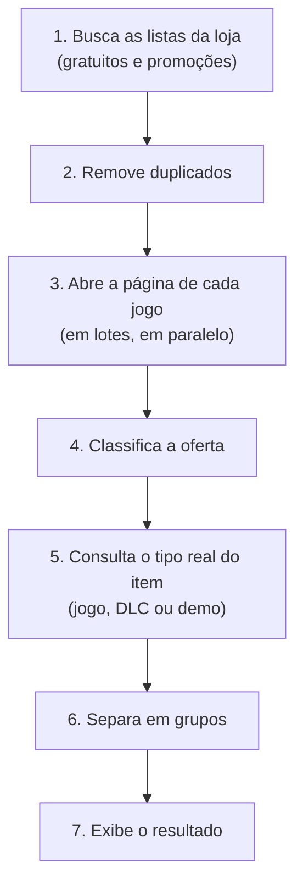

# Steam_Gratis.ps1

Script em PowerShell que lista, direto no terminal, os jogos, DLCs e pacotes que estão **gratuitos na Steam agora**: fins de semana grátis, promoções de 100% de desconto e jogos *free-to-play*, com a data de término de cada oferta.


---

### Exemplos de saída

**Tela de carregamento:** barra de progresso do `Write-Progress` e animação de uma linha.


**Resultado completo:** grupo de jogos temporários e de DLCs.


**Console comum:** o resultado termina com o aviso para sair com Ctrl+C.


> Os nomes e as datas mudam a cada execução.

## Sumário

1. [Introdução](#1-introdução)
   - 1.1 [Problema](#11-problema)
   - 1.2 [Situação](#12-situação)
2. [Estratégias de solução](#2-estratégias-de-solução)
   - 2.1 [Detalhamento](#21-detalhamento)
   - 2.2 [Ferramentas](#22-ferramentas)
3. [Desenvolvimento](#3-desenvolvimento)
4. [Próximos passos](#4-próximos-passos)
5. [Referências](#5-referências)

---

## 1. Introdução

A Steam oferece itens gratuitos de formas diferentes, e cada uma aparece de um jeito na loja. Acompanhar tudo manualmente significa abrir a página de vários jogos, ler datas e conferir se o item pode mesmo ser baixado. O `Steam_Gratis.ps1` automatiza essa conferência e entrega, em uma única execução, uma lista organizada do que está disponível naquele momento.

### 1.1 Problema

Saber o que está gratuito na Steam hoje não é trivial, por quatro motivos:

- **Há três tipos de "grátis".** O *fim de semana grátis* mantém o preço normal e só libera o jogo até uma data. A promoção de *100% de desconto* (comum em DLCs) permite resgatar o item para sempre antes de uma data. O *free-to-play* é gratuito de forma permanente.
- **A busca da loja não mostra tudo.** O filtro de preço zero (`maxprice=free`) não lista os fins de semana grátis, porque o jogo continua com preço normal.
- **A data de término fica na página de cada item.** Ela não aparece nos resultados de busca, e as promoções de 100% e os fins de semana grátis usam frases diferentes.
- **Nem tudo que parece grátis pode ser baixado.** Há itens ainda não lançados, ou sem o botão de jogar ou de obter, que aparecem com preço zero.

### 1.2 Situação

Este projeto nasceu da necessidade de ter, em poucos segundos e sem abrir o navegador, uma resposta confiável para a pergunta: *"o que posso baixar de graça agora, e até quando?"*

A primeira tentativa foi ler o SteamDB com `Invoke-WebRequest`. Ela foi descartada porque o site respondeu **HTTP 403 (Proibido)** a requisições feitas pelo PowerShell, e nenhum ajuste de cabeçalho resolveu. Por isso o script usa a própria loja da Steam como fonte.

---

## 2. Estratégias de solução

### 2.1 Detalhamento

O script percorre as etapas abaixo, nesta ordem:



**Coleta.** São lidas duas listas da busca da loja, em páginas de 50 itens:

| Lista | Filtro | Para que serve |
|-------|--------|----------------|
| `gratis` | `maxprice=free` e `specials=1` | Itens com preço zero em promoção (inclui DLCs de 100% de desconto) |
| `scan` | `specials=1` | Promoções em geral, varridas atrás de fins de semana grátis |

**Classificação.** Para cada jogo, a página da loja é aberta e a situação é definida, nesta ordem de prioridade:

| Situação | Como é detectada | Data de término |
|----------|------------------|-----------------|
| **Fim de semana grátis** | A página traz "Jogue gratuitamente até..." | Está na própria frase |
| **Tempo limitado (100%)** | Preço final zero e desconto de 100%, com "Obtenha antes de..." ou "Oferta válida até..." | Está na própria frase |
| **Gratuito para jogar** | Preço zero na lista `gratis`, sem promoção | Não se aplica |

Pacotes e bundles gratuitos vêm apenas da lista `gratis` e aparecem no grupo "Outros (Demos, Pacotes e Bundles)".

**Disponibilidade.** Um item só entra no resultado se puder ser baixado:

- fim de semana grátis: precisa do botão **Jogar** na página (`steam://run/<id>`);
- 100% de desconto: precisa do botão de adicionar à conta (`addToCart(`);
- itens marcados como "em breve" ou ainda não lançados são descartados;

**Tipo real.** A API `appdetails` informa se o item é jogo, DLC ou demo. Para DLCs, o script mostra também o jogo exigido ("Requer o jogo: ...").

**Grupos exibidos:**

1. **Jogos disponíveis para baixar temporariamente** (fim de semana grátis e 100% de desconto, exceto DLCs);
2. **Jogos grátis** (*free-to-play* permanente);
3. **DLCs**;
4. **Outros** (demos, pacotes e bundles).

Se todos os itens do primeiro grupo terminam na mesma data, ela é colocada no título do grupo.

### 2.2 Ferramentas

| Ferramenta | Uso no projeto |
|------------|----------------|
| **PowerShell 5.1+** | Linguagem do script (`#Requires -Version 5.1`) |
| **`System.Net.Http.HttpClient`** | Download das páginas dos jogos em paralelo |
| **`Invoke-RestMethod`** | Leitura da busca da loja e da API `appdetails` |
| **Expressões regulares (.NET)** | Extração de nomes, preços e datas do HTML |
| **`Write-Progress` e animação de linha** | Barra de progresso e indicador giratório no terminal |
| **Loja da Steam** | Fonte dos dados (busca, páginas dos jogos e `api/appdetails`) |

Detalhes de implementação que valem destaque:

- **Cabeçalhos:** o `User-Agent` usa a versão do Chrome instalada (ou uma versão padrão, se não houver) e os *cookies* de verificação de idade e de fuso horário de Brasília, para que a data apareça no horário local.
- **Caracteres escapados:** o HTML da Steam traz acentos como `é`, que são convertidos no caractere real antes da leitura.
- **Idioma e região:** todas as consultas usam `cc=br&l=brazilian`, e as frases procuradas estão em português.

---

## 3. Desenvolvimento

### 3.1 Como executar

**Requisitos:** Windows com PowerShell 5.1 ou superior e acesso à internet.

```powershell
# execução padrão
.\Steam_Gratis.ps1

# varrendo mais páginas de promoções
.\Steam_Gratis.ps1 -PaginasScan 10
```

Se o PowerShell bloquear a execução de scripts, libere para a sessão atual:

```powershell
Set-ExecutionPolicy -Scope Process -ExecutionPolicy Bypass
```

O script pode ser aberto no **PowerShell ISE** (pressione **F5**) ou rodado em um console comum. A animação foi desenhada com o ISE em mente. No console comum, o script permanece aberto ao final e é encerrado com **Ctrl+C**.

### 3.2 Parâmetros

| Parâmetro | Padrão | Descrição |
|-----------|--------|-----------|
| `-PaginasGratis` | `2` | Páginas da lista de itens gratuitos (50 itens cada) |
| `-PaginasScan` | `4` | Páginas de promoções varridas atrás de fins de semana grátis (50 itens cada) |
| `-Lote` | `10` | Quantidade de páginas de jogos baixadas ao mesmo tempo |


### 3.3 Estrutura do código

O arquivo é dividido em seções numeradas, na ordem de execução:

| Seção | Conteúdo |
|-------|----------|
| 1 | Parâmetros |
| 2 | Título inicial |
| 3 | Infraestrutura (cliente HTTP, cabeçalhos e cookies) |
| 4 | Conversão de caracteres escapados |
| 5 | Funções auxiliares e animação (`Barra`, `Limpa`, `Novo`) |
| 6 | Coleta dos itens da busca (`Get-Itens`) |
| 7 | Classificação (`Get-Achado`) |
| 8 | Pacotes e bundles |
| 9 | Download das páginas em lotes (`Start-Lote`) |
| 10 | Tipo real e conferência de lançamento |
| 11 e 12 | Separação em grupos e título com a data |
| 13 | Exibição do resultado (`Secao`) |
| 14 | Saída no console |

Uma decisão de desempenho: enquanto um lote de páginas é processado, o **próximo lote já está sendo baixado**, o que reduz a espera entre um número e outro na barra de progresso.

### 3.4 Limitações conhecidas

- **Cobertura da varredura:** os fins de semana grátis só são encontrados entre os `-PaginasScan × 50` primeiros itens da lista de promoções, que a Steam ordena por relevância. Em 13/10/2026, a loja brasileira listava 16.330 itens em promoção. Varrer tudo exigiria mais de 16 mil requisições, o que não é prático e pode levar a Steam a recusar pedidos.
- **Dependência do HTML da loja:** as datas são extraídas de frases em português ("Jogue gratuitamente até", "Obtenha antes de", "Oferta válida até"). Se a Steam mudar o texto ou a estrutura das páginas, a data pode aparecer como "data de termino nao encontrada".
- **Endpoints não documentados:** a busca (`search/results`) e o `appdetails` não fazem parte da API oficial documentada da Steam e podem mudar sem aviso.
- **Itens indisponíveis não são listados:** itens não lançados ou sem botão de jogar ou obter ficam de fora do resultado.
- **Janela do ISE:** o PowerShell ISE não consegue mover o cursor para animar várias linhas. Por isso a animação é de uma linha só, acompanhada da barra de progresso.

> **Aviso:** este projeto não é afiliado à Valve nem à Steam. Ele apenas lê páginas públicas da loja para uso pessoal.

---

## 4. Próximos passos

- [ ] Parâmetro `-IdsExtras` para sempre verificar AppIDs informados pelo usuário, mesmo fora das páginas varridas.
- [ ] Exportar o resultado para CSV ou JSON.
- [ ] Notificação (por exemplo, no Windows) quando surgir um novo item gratuito.
- [ ] Execução agendada, com histórico dos itens já vistos.
- [ ] Suporte a outros idiomas e regiões, parametrizando as frases procuradas e os códigos `cc` e `l`.
- [ ] Testes automatizados (por exemplo, com [Pester](https://pester.dev)) usando páginas HTML de exemplo.
- [ ] Tratamento explícito de limite de requisições (*rate limit*) e *log* de erros.
- [ ] Definir e adicionar uma licença ao repositório.

---

## 5. Referências

- [Steam: loja](https://store.steampowered.com), fonte das listas de promoções e das páginas dos jogos.
- [SteamDB](https://steamdb.info), alternativa avaliada e descartada por bloquear requisições do PowerShell (HTTP 403).
- [`Invoke-RestMethod`](https://learn.microsoft.com/powershell/module/microsoft.powershell.utility/invoke-restmethod), Microsoft Learn.
- [`Write-Progress`](https://learn.microsoft.com/powershell/module/microsoft.powershell.utility/write-progress), Microsoft Learn.
- [`HttpClient` (.NET)](https://learn.microsoft.com/dotnet/api/system.net.http.httpclient), Microsoft Learn.
- [Linguagem de expressões regulares do .NET](https://learn.microsoft.com/dotnet/standard/base-types/regular-expression-language-quick-reference), Microsoft Learn.

---

Desenvolvido por **Herzz09**.
